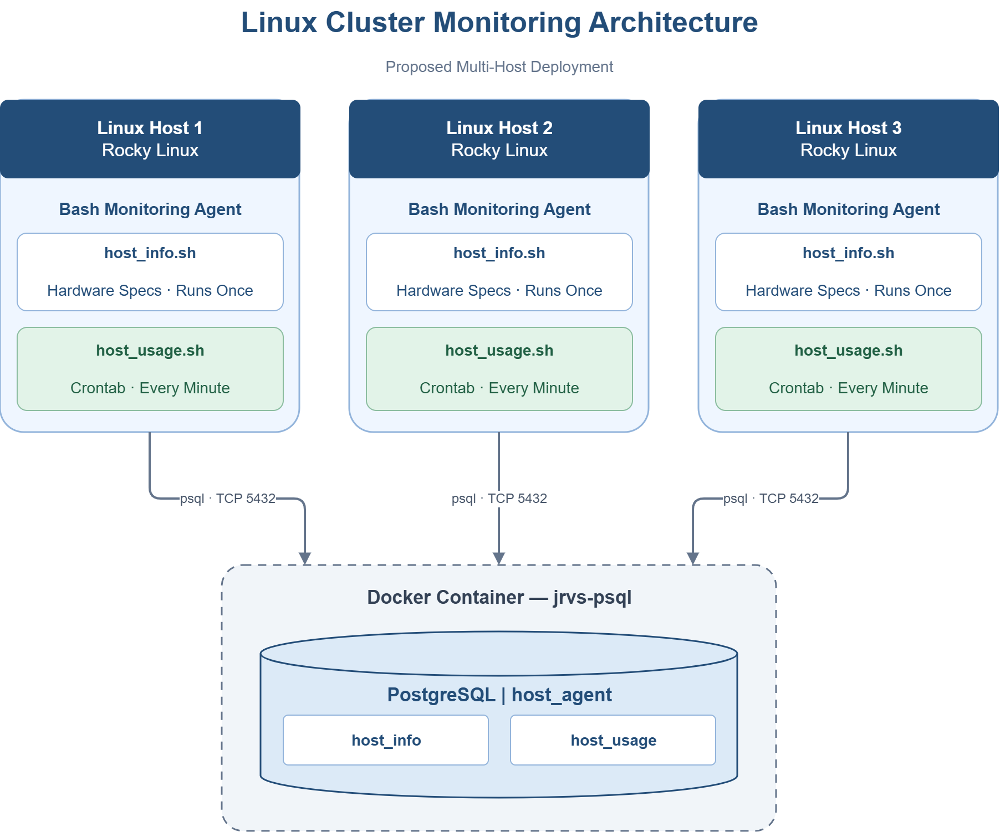

# Linux Cluster Monitoring Agent

## Introduction

The Linux Cluster Monitoring Agent is a monitoring application designed to help system administrators collect and analyze hardware specifications and resource usage across Linux servers. The application collects hardware information such as CPU specifications, architecture, and total memory. It also monitors resource usage, including available memory, CPU activity, disk activity, and available disk space.

The project uses Bash scripts and Linux commands to extract and process system information, which is then stored in a PostgreSQL database running inside a Docker container. Crontab automates resource usage collection every minute, allowing administrators to monitor server performance and support future resource planning. Git and GitHub are used for version control, while GitFlow provides a structured development workflow through separate feature branches.

## Quick Start

Run the following commands from the `linux_sql` directory.

### 1. Create and start a PostgreSQL container

For the initial setup:

```bash
bash scripts/psql_docker.sh create postgres password
```

To start an existing container:

```bash
bash scripts/psql_docker.sh start
```

### 2. Create the database and tables

```bash
psql -h localhost -U postgres -W
```

Create the database:

```sql
CREATE DATABASE host_agent;
```

Exit PostgreSQL using `\q` and execute the DDL script:

```bash
psql -h localhost -U postgres -d host_agent -f sql/ddl.sql
```

### 3. Collect hardware specifications

```bash
bash scripts/host_info.sh localhost 5432 host_agent postgres password
```

### 4. Collect resource usage data

```bash
bash scripts/host_usage.sh localhost 5432 host_agent postgres password
```

### 5. Automate resource usage collection

Open the crontab editor:

```bash
crontab -e
```

Add the following scheduled job, replacing the script path with the absolute path on your machine:

```bash
* * * * * bash /absolute/path/scripts/host_usage.sh localhost 5432 host_agent postgres password > /tmp/host_usage.log
```

Verify the scheduled job:

```bash
crontab -l
```

The password shown in these commands is an example for the development environment.

## Implementation

The application was implemented using Bash scripts to collect system information from a Rocky Linux instance. Linux commands such as `lscpu`, `vmstat`, `hostname`, and `df` retrieve system information. Commands such as `grep`, `awk`, and `xargs` are used to extract and format the required values before inserting them into PostgreSQL.

### Architecture



The application is designed to support multiple Linux hosts connected to a centralized PostgreSQL database. Each host runs the hardware information script once and the resource usage script every minute.

The application was implemented and tested on a single Linux instance.

### Scripts

#### psql_docker.sh

Manages the PostgreSQL Docker container through three operations: create, start, and stop. A Docker volume named `pgdata` is used to persist database information.

```bash
bash scripts/psql_docker.sh create postgres password
bash scripts/psql_docker.sh start
bash scripts/psql_docker.sh stop
```

#### host_info.sh

Collects hardware specifications from the Linux host and inserts the information into the `host_info` table. The script is intended to run once for each host.

```bash
bash scripts/host_info.sh localhost 5432 host_agent postgres password
```

#### host_usage.sh

Collects resource usage statistics and inserts them into the `host_usage` table. It retrieves the corresponding host ID using the hostname.

```bash
bash scripts/host_usage.sh localhost 5432 host_agent postgres password
```

#### crontab

Schedules the resource usage script to execute every minute, allowing monitoring data to be collected automatically.

```bash
crontab -e
crontab -l
```

#### queries.sql

This file is reserved for analytical queries that will help administrators evaluate hardware capacity and resource usage. These queries have not yet been implemented.

### Database Modeling

The database consists of two tables: `host_info` and `host_usage`. The tables have a one-to-many relationship, where one host can have multiple resource usage records.

#### host_info

| Column | Data Type | Description |
| --- | --- | --- |
| id | SERIAL | Primary key identifying each host |
| hostname | VARCHAR | Unique hostname |
| cpu_number | INT2 | Number of CPUs |
| cpu_architecture | VARCHAR | CPU architecture |
| cpu_model | VARCHAR | CPU model |
| cpu_mhz | FLOAT8 | CPU frequency in MHz |
| l2_cache | INT4 | L2 cache size in KiB |
| timestamp | TIMESTAMP | Hardware information collection time in UTC |
| total_mem | INT4 | Total memory in kB |

#### host_usage

| Column | Data Type | Description |
| --- | --- | --- |
| timestamp | TIMESTAMP | Resource usage collection time in UTC |
| host_id | SERIAL | Foreign key referencing host_info |
| memory_free | INT4 | Free memory in MiB |
| cpu_idle | INT2 | CPU idle percentage |
| cpu_kernel | INT2 | CPU kernel usage percentage |
| disk_io | INT4 | Disk I/O statistic |
| disk_available | INT4 | Available disk space in MiB |

## Test

The application was tested manually on a Rocky Linux instance.

- The PostgreSQL container was started and verified using `docker ps`.
- The DDL script was executed to verify that the database table definitions could be processed.
- Sample records were inserted to verify the database structure.
- Bash syntax was checked using `bash -n`.
- Both monitoring scripts were executed manually to verify successful database inserts.
- SQL SELECT statements were used to confirm that the collected information was stored correctly.
- Crontab was configured and tested by checking that new resource usage records appeared approximately one minute apart.

During testing, a duplicate primary key error occurred because manually inserted sample records had not updated the ID sequence. The sequence was synchronized with the existing records, resolving the issue without deleting the sample data.

## Deployment

The application was deployed on a Jarvis Remote Desktop Linux instance. PostgreSQL was hosted inside a Docker container, with a Docker volume providing persistent database storage.

Crontab was configured to execute the resource usage script every minute. Git and GitHub were used to manage source code, with separate feature branches created for individual development tasks and merged into the develop branch.

## Improvements

- Support automatic updates when a host's hardware specifications change.
- Implement better error handling and logging to identify database connection failures and unsuccessful data collection.
- Improve credential management by avoiding plain-text passwords in scheduled commands.
- Develop a monitoring dashboard to visualize resource usage over time.
- Improve CPU and disk usage measurements to provide more accurate monitoring statistics.

